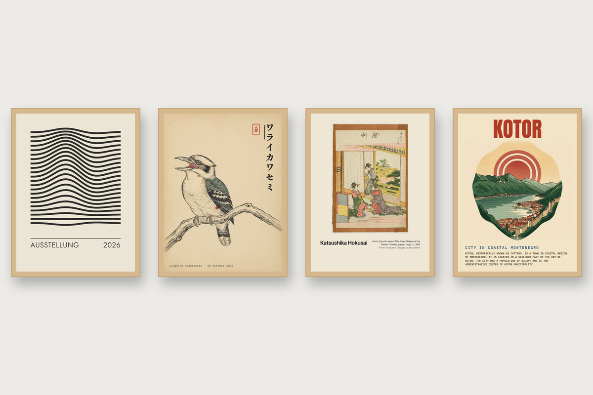

# Poster

A framed print for the wall, new each day: a Tesserae widget in fourteen
styles. Six are drawn from a seed, two hang public-domain museum prints, and
six are AI posters whose words are set in real type.



## The styles

| Style | Kind | What it is |
| --- | --- | --- |
| Ausstellung | drawn, free | Bauhaus exhibition prints: dot grids, rings, waves, quarter-circle tiles, stripes, nested squares |
| Swiss | drawn, free | Huge lowercase type, a black disc, a coloured disc and a rule, with the week and day of the year |
| Constructivist | drawn, free | A red diagonal, a black circle and slanted type on a black bar |
| Ridgeline | drawn, free | Stacked white waves on black |
| Memphis | drawn, free | Confetti squiggles, zigzags and shapes round a boxed title |
| Sunburst | drawn, free | A mid-century sun with rays over layered hills |
| Gallery print | museum, free | A public-domain painting from the Art Institute of Chicago, hung with its label |
| Japanese woodblocks | museum, free | Hiroshige, Hokusai, Kuniyoshi, Utamaro and others, the same way |
| Woodblock | AI | An ink-line print of a bird or animal with its Japanese name set vertically and a seal for the weekday |
| Travel poster | AI | A screen-printed scene with the place name, an optional year and small print from Wikipedia |
| Art deco | AI | A 1930s national-park poster with the park's name in a deco face |
| Risograph | AI | A two-ink print with the subject's name overprinted in fluorescent pink |
| Botanical plate | AI | An engraved plate with the plate number, the Latin name and the common name |
| Linocut | AI | Carved black ink with one accent colour and a slab-serif name |

Two mixes rotate through them: every free style, or every style including AI.

The drawn styles take a title and a second line. `{weekday}`, `{day}`,
`{month}`, `{monthnum}` and `{year}` become to-day's, so most of them double as
a date poster.

## AI posters

An AI poster asks fal.ai for a picture only, and never for lettering. The
widget sets the name, label, year and small print over the picture in
bundled fonts, so a place name, a Japanese label or a date always comes out
right.

The pictures go through Tesserae's Artwork API (Tesserae 0.463 or later):

- **Painted once.** Each subject is painted once per style and shape, then
  kept and reused.
- **Budget.** A daily budget caps spending. Nano Banana costs about US$0.04
  a poster and FLUX Schnell about US$0.01.
- **Hold.** A preview in the editor holds its picture until you choose
  Paint now.
- **Pictures page.** The kept pictures are listed under Plugins › Poster, by
  style.

While a period's picture is being painted the poster shows the last one of the
same style and shape, with that picture's own words.

The key is the widget's own `fal_api_key` setting, or the one under Settings ›
Generative AI. Without one the free styles still work.

### Subjects

Each AI style has its own list of birds, places, parks, plants or things,
taken in turn. Give your own in the cell's Subjects box, one a line:

```
Aireys Inlet | Split Point | 1891
Laughing kookaburra | ワライカワセミ
Banksia serrata
```

The second field is a label (a woodblock's Japanese name, a travel poster's
second line). The third is a year. The subject is looked up on Wikipedia for
the small print and, on a woodblock, the Japanese title of its article.

## Options

| Option | Notes |
| --- | --- |
| `style` | One of the fourteen, or a mix |
| `change` | Every day, week, hour or render |
| `title`, `subtitle` | The words on a drawn poster, with the placeholders above |
| `subjects` | AI styles: one subject a line, `subject \| label \| year` |
| `facts` | Small print from Wikipedia on the travel, linocut and botanical posters |
| `model` | Nano Banana or FLUX.1 Schnell |
| `museum_query` | Your own search of the museum's public-domain works, such as `Mondrian` |

## Sources and credits

- **Museum prints.** These come from the
  [Art Institute of Chicago API](https://api.artic.edu/docs/), public-domain
  works only, credited on the poster.
- **Wikipedia.** The small print and Japanese names come from Wikipedia
  (CC BY-SA 4.0).
- **Fonts.** The faces are bundled from Google Fonts under the SIL Open Font
  License; see `fonts/LICENSE-*.txt`. They are Jost, Anton, Inter Tight,
  IBM Plex Mono, Poiret One, Cormorant Garamond, Alfa Slab One and Bungee.
  The Japanese label uses Shippori Mincho, fetched from Google Fonts cut down
  to the characters it needs, and kept.

`python tools/fetch_fonts.py` fetches the bundled faces again.

## Tests

```
PYTHONPATH=../tesserae pytest tests
```

## Licence

AGPL-3.0-or-later.
